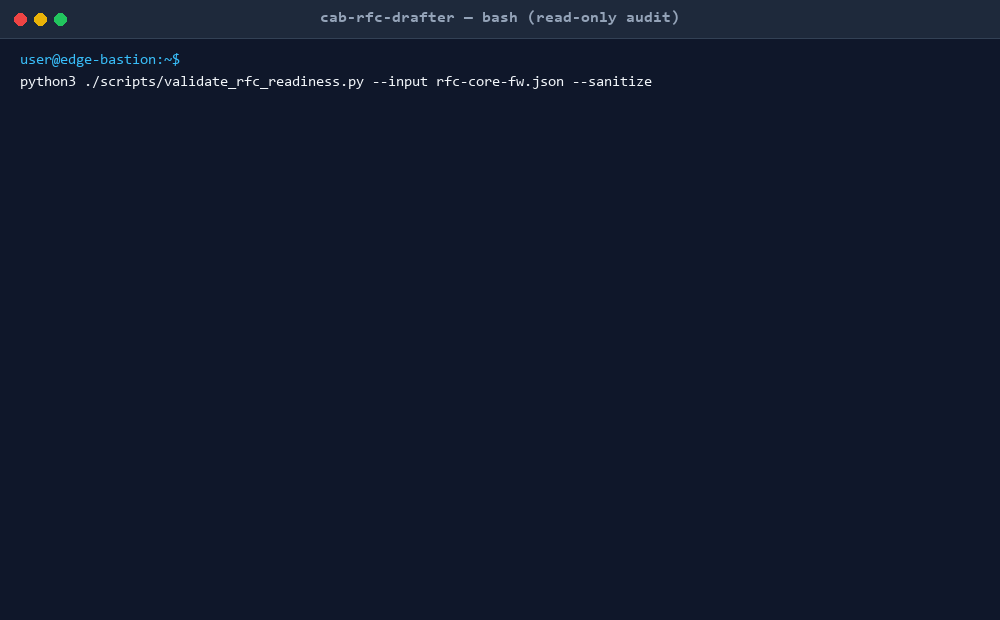

# CAB Risk & Rollback RFC Drafter (`cab-rfc-drafter`)



An ITIL 4-aligned Change Enablement AI Agent Skill paired with a deterministic validation engine. Conducts structured change management interviews, challenges missing dependencies and test gaps, calculates objective 4-dimension risk scores, audits maintenance window feasibility, and outputs audit-compliant Request for Change (RFC) packages ready for Change Advisory Board (CAB) approval.

---

## Executive Overview (Plain-English Summary)

### The One-Sentence Pitch
`cab-rfc-drafter` automates the drafting, risk scoring, and time window validation of IT infrastructure Change Requests, eliminating rejected CAB submissions and preventing failed production changes.

### The Real-World Problem
In enterprise IT, up to 75% of unplanned downtime stems from poorly planned configuration changes. Infrastructure engineers routinely submit vague, rushed Change Requests (e.g., *"upgrading core switch firmware"*) lacking concrete rollback commands, realistic outage windows, pre-change health baselines, or post-change verification tests. Weak RFCs lead to prolonged CAB debates, delayed maintenance schedules, and catastrophic production outages when an untested change cannot be rolled back in time.

### The 3-Step Walkthrough
1. **Intake & Interview:** The engineer uploads a draft JSON outline or completes an interactive 2-minute CLI questionnaire covering change scope, target systems, step timings, and backout commands.
2. **Deterministic Audit:** The local engine validates the change across five architectural layers: verifying mandatory ITIL sections, calculating a 4-dimension risk score (Scope, Redundancy, Reversibility, Precedent), auditing window headroom ($T_{\text{impl}} + T_{\text{rollback}} + T_{\text{buffer}} \le T_{\text{window}}$), and asserting Go/No-Go decision cutoff viability.
3. **Synthesis & Export:** Generates an audit-ready Markdown RFC document, a pre-formatted ITSM ticket description (for ServiceNow or Jira Service Management), and an actionable defect remediation list if revisions are needed.

### Why IT Leadership Approves
- **Zero Third-Party Dependencies:** Written purely in standard Python (`json`, `argparse`, `hashlib`, `re`, `datetime`). Zero `pip install`, zero external network calls, and zero risk of EDR/Defender flags.
- **Client-Side Data Sanitization (Rule 4):** Automated `--sanitize` mode masks engineer identities, internal hostnames, and corporate domain names while mapping IP addresses to RFC 5737 documentation ranges (`192.0.2.x`). Sensitive internal telemetry never touches an external LLM.
- **Guaranteed Window Headroom:** Mathematically prevents window overruns by requiring at least 15% contingency buffer and establishing an immutable Go/No-Go decision deadline before work begins.

---

## 4-Dimension Change Risk Matrix

| Risk Dimension | Low Risk (1 pt) | Medium Risk (2 pts) | High Risk (3 pts) |
| :--- | :--- | :--- | :--- |
| **1. User Impact Scope** | Internal IT / < 10 users | Departmental / 10–250 users | Enterprise-wide / Customer-facing |
| **2. Service Redundancy** | Active-Active HA pair | Failover cluster (< 30s pause) | Standalone / Single point of failure |
| **3. Reversibility** | Instant (< 5 mins) | Tested backout (< 20 mins) | Irreversible / Data loss potential |
| **4. Operational Precedent** | Standard routine task | Tested in staging/lab | Novel / First-time architectural change |

### Scoring Tiers
- **4–6 points:** **Low Risk (Standard Change)** – Pre-approved; delegated to peer engineer.
- **7–9 points:** **Medium Risk (Normal Change)** – Peer review, Service Owner sign-off, and weekly CAB review.
- **10–12 points:** **High Risk (Major Change)** – Mandatory full CAB review, sponsor sign-off, and live bridge.

---

## Repository Structure

```text
cab-rfc-drafter/
├── SKILL.md                               # ITIL 4 operational skill specification
├── README.md                              # Technical overview and installation guide
├── LICENSE                                # Apache 2.0 license
├── .gitignore                             # Git ignore file
├── scripts/
│   ├── validate_rfc_readiness.py          # 5-layer validation & risk scoring CLI engine
│   └── draft_cab_rfc.py                   # Interactive & batch RFC drafting wizard
├── references/
│   ├── cab-risk-rubric.md                 # 4-dimension risk calculation matrix
│   ├── itil-change-categories.md          # Standard vs. Normal vs. Emergency definitions
│   └── maintenance-window-guidelines.md   # Mathematical window headroom & cutoff formulas
├── assets/
│   ├── cab-rfc-document-template.md       # Output RFC submission package template
│   ├── itsm-change-ticket-template.md     # Pre-formatted ITSM ticket description
│   ├── demo.gif                           # Animated terminal demo recording
│   └── demo.mp4                           # High-definition video recording
└── tests/
    ├── validate-skill.py                  # Core rule compliance test harness
    ├── test_cab_rfc_engine.py             # Functional unit tests
    ├── stress_test_cab_rfc.py             # Performance benchmark & ReDoS suite
    ├── extreme_adversarial_suite.py       # Chaos and edge-case test suite
    └── fixtures/                          # 100% synthetic test fixtures
        ├── fixture-valid-major-firewall-upgrade.json
        ├── fixture-failing-missing-rollback.json
        ├── fixture-failing-window-overrun.json
        ├── fixture-valid-normal-cert-renewal.json
        ├── fixture-failing-vague-steps.json
        └── fixture-valid-standard-dns-ttl.json
```

---

## Quick-Start Usage

### 1. Audit an Existing Draft RFC
Validate a draft change request against CAB readiness standards:
```bash
python3 ./scripts/validate_rfc_readiness.py --input tests/fixtures/fixture-valid-major-firewall-upgrade.json --format markdown
```

### 2. Run with Client-Side Data Sanitization
Mask all internal hostnames, engineer emails, and IP addresses before sharing:
```bash
python3 ./scripts/validate_rfc_readiness.py --input tests/fixtures/fixture-valid-major-firewall-upgrade.json --sanitize --output sanitized_audit.json
```

### 3. Draft an RFC Interactively via CLI Wizard
Conduct an interactive terminal interview to produce a CAB-ready RFC:
```bash
python3 ./scripts/draft_cab_rfc.py --interactive --output my_rfc.json --report my_rfc_report.md
```

### 4. Generate Starter RFC JSON Template
Export a reference starter template:
```bash
python3 ./scripts/draft_cab_rfc.py --sample --output starter_rfc.json
```

---

## Installation & Setup in AI Agent Environments

### Antigravity & AgentSkills.io
Clone or copy the directory directly into your workspace:
```bash
git clone https://github.com/ToritsejuBoyo/cab-rfc-drafter.git
```
Antigravity automatically discovers `SKILL.md` and activates the skill when you mention change requests, RFC drafting, rollback plans, or CAB preparation.

### Claude Code
Add the skill folder to your `.claude/skills/` directory:
```bash
mkdir -p ~/.claude/skills
cp -r cab-rfc-drafter ~/.claude/skills/
```

### Cursor & Local IDEs
Reference the skill in your project prompts or `.cursorrules`:
```markdown
When drafting or reviewing infrastructure change requests, follow the guidelines and rubrics in cab-rfc-drafter/SKILL.md.
```

### Offline Local LLMs (Ollama)
Execute the Python companion validation scripts locally to generate the markdown report, then feed the sanitized output directly to local Ollama models (`qwen2.5-coder:14b` or `llama3.1:8b`).

---

## Verification & Testing Suite

All tests execute locally using standard Python libraries with zero external dependencies:

```bash
# 1. Core Rule Compliance & Synthetic Fixture Test Harness
python3 tests/validate-skill.py

# 2. Functional Unit Tests
python3 tests/test_cab_rfc_engine.py

# 3. High-Throughput Stress & ReDoS Benchmark
python3 tests/stress_test_cab_rfc.py

# 4. Extreme Adversarial & Chaos Suite
python3 tests/extreme_adversarial_suite.py
```

---

## Operational Limits & Non-Goals
- **Read-Only Telemetry:** This skill does not automatically execute change procedures or initiate rollback commands on live systems. All proposed commands require human engineering execution and verification.
- **ITSM System of Record:** This tool drafts and validates RFC content; it does not replace ServiceNow, Jira Service Management, or change governance approval workflows.

---

## License
Apache License 2.0. See [LICENSE](LICENSE) for details.
